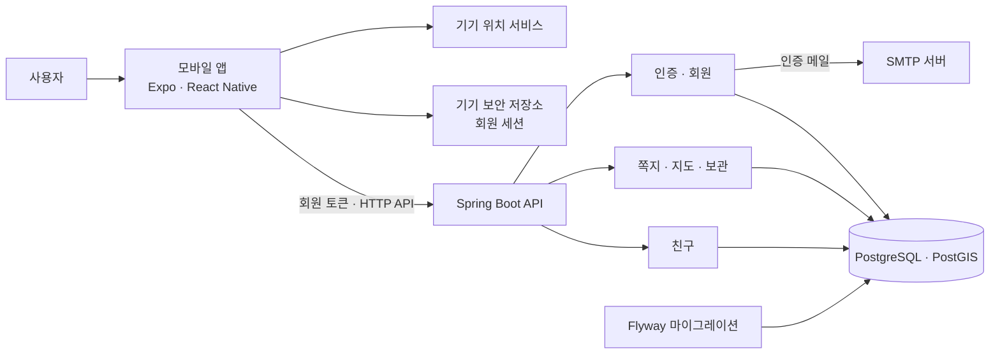

# 여기남김

**여기남김**은 장소에 쪽지를 남기고, 지도에서 주변 쪽지를 발견하는 모바일 앱입니다. 쪽지를 찾아 가까이 가서 읽고, 기억하고 싶은 쪽지는 저장해 다시 볼 수 있습니다.

## 주요 기능

**지도에서 발견 → 가까이서 읽기 → 쪽지 남기기 → 보관함에서 다시 보기**

### 🗺️ 발견하고 읽기

- **공개 지도·친구 지도**를 전환하며 쪽지 위치를 찾습니다. 가까운 쪽지는 개수가 적힌 물방울 마커로 묶어 보여줍니다.
- 다른 사람의 미저장 쪽지는 **현재 위치에서 150m 이내**일 때 읽을 수 있습니다. 범위 밖에서는 잠금 상태로 표시합니다.
- 친구 쪽지는 마커에서 **안 읽음·읽음·저장·잠금** 상태를 구분합니다. 공개 지도에서는 태그로 쪽지를 골라 볼 수 있습니다.

### ✍️ 남기기

- 장소에 쪽지를 남기고 공개 범위를 **전체 공개·친구 공개·나만 보기** 중에서 선택합니다.
- **맛집·카페·추억·고민·감동·일상** 중 하나의 태그를 선택합니다.

### 📁 저장하고 다시 보기

- 다른 사람의 쪽지는 책갈피로 **저장·저장 취소**할 수 있습니다. 내가 쓴 쪽지는 자동으로 보관함에 들어가며 삭제할 수 있습니다.
- 지도 속 보관함에서는 **내가 쓴 쪽지·저장한 쪽지의 위치**를, 보관함 탭에서는 **달력과 날짜별 목록**을 봅니다.
- 내가 쓴 쪽지와 저장한 쪽지는 거리에 관계없이 다시 읽을 수 있습니다.

### 👥 친구와 MY

- 초대 링크나 일회용 코드로 친구를 추가하고, 친구 공개 쪽지 소식에서 해당 위치의 친구 지도로 이동합니다.
- MY에서 프로필·활동 기록을 확인하고 계정과 위치 권한을 관리합니다.

## 시스템 아키텍처



- 앱은 기기 위치로 현재 위치와 열람 반경을 표시하고, API에 쪽지·친구·회원 정보를 요청합니다.
- 서버는 회원 인증, 공개 범위·친구 관계·거리 조건을 확인합니다. 위치 기반 조회와 거리 계산에는 PostGIS를 사용합니다.
- 회원 세션은 모바일 기기의 보안 저장소에 보관하며, DB 구조는 Flyway 마이그레이션으로 관리합니다.

## 사용자 시나리오

### 1. 주변 쪽지를 발견하고 저장하기

1. 로그인한 사용자가 지도에서 **공개 지도** 또는 **친구 지도**를 선택합니다.
2. 지도를 탐색하다 쪽지 물방울을 누릅니다. 멀리 있는 쪽지는 잠겨 있고, 가까이 이동하면 열람할 수 있습니다.
3. **150m 이내**에서 쪽지를 읽고, 다시 보고 싶은 쪽지는 책갈피로 저장합니다.
4. 나중에 지도 속 보관함에서 위치를 찾거나, 보관함 탭의 달력에서 작성 날짜별로 다시 읽습니다.

### 2. 장소에 쪽지를 남기고 친구와 공유하기

1. 지도에서 쪽지 작성 화면을 열고 내용, 공개 범위, 태그를 선택합니다.
2. 쪽지를 남기면 해당 위치에 표시되고, **내가 쓴 쪽지**로 보관함에 들어갑니다.
3. **친구 공개**로 남긴 쪽지는 친구 지도와 친구 소식에서 찾을 수 있습니다. 친구는 쪽지 위치로 이동해 거리 조건에 따라 열람합니다.

## 기술 스택

| 영역 | 기술 |
| --- | --- |
| 모바일 앱 | Expo 57, React Native 0.86, Expo Router, TypeScript, MapLibre React Native |
| API 서버 | Java 21, Spring Boot 4.1, Spring Web MVC, Spring Data JPA, Gradle |
| 데이터베이스 | PostgreSQL 18, PostGIS, Flyway |
| 개발·검증 | Docker Compose, JUnit, ESLint, TypeScript |

## 로컬에서 실행하기

### 준비물

- Node.js와 npm, JDK 21, Docker Engine 및 Docker Compose
- Android 실행: Android Studio, Android SDK, 에뮬레이터 또는 실제 기기
- iOS 로컬 빌드: macOS와 Xcode

### 1. 데이터베이스와 API 서버

```bash
cd backend
cp .env.example .env
```

`backend/.env`에서 `DB_PASSWORD`를 로컬 개발용 값으로 설정합니다. 회원 기능을 사용하려면 `AUTH_ENABLED=true`와 JWT·이메일 인증 관련 값을 추가로 설정해야 합니다. 필요한 변수와 SMTP 설정은 [백엔드 실행 가이드](backend/README.md)와 [이메일 인증 API 문서](docs/EMAIL_AUTH_API.md)를 참고하세요.

```bash
docker compose up -d --wait
./gradlew bootRun
```

API 서버의 기본 주소는 `http://localhost:8080`입니다. 명령은 `backend/`에서 실행해야 서버가 `.env`를 읽습니다. Apple Silicon에서는 DB 이미지의 `linux/amd64` 실행 지원이 필요합니다.

### 2. 모바일 앱

별도 터미널에서 저장소 루트 기준으로 실행합니다.

```bash
cd frontend
npm ci
cp .env.local.example .env.local
npm run android
```

iOS에서는 마지막 명령 대신 `npm run ios`를 사용합니다. 예시 API 주소 `http://10.0.2.2:8080`은 **Android 에뮬레이터** 기준입니다. 실제 기기에서는 기기와 개발 PC를 같은 네트워크에 연결하고 `frontend/.env.local`의 `EXPO_PUBLIC_API_BASE_URL`을 개발 PC의 LAN IP로 바꿉니다. iOS 등 다른 실행 환경의 주소도 해당 환경에 맞게 설정하세요. 네이티브 지도 모듈을 사용하므로 개발 빌드 명령으로 실행합니다. 자세한 내용은 [프론트엔드 실행 가이드](frontend/README.md)에 있습니다.

## 검사 명령

```bash
cd backend
./gradlew test
```

백엔드 테스트는 로컬 DB와 `backend/.env` 설정을 사용합니다.

```bash
cd frontend
npm run lint
npx tsc --noEmit
npm run test:auth
npm run test:member
npm run test:friends
```

## 저장소 구조

```text
backend/   Spring Boot API, Flyway 마이그레이션, 테스트
frontend/  Expo 앱, 화면·컴포넌트, API 클라이언트
docs/      기능별 API 계약과 협업 문서
```

## 팀원

### 💡 기획

|  |
| :---: |
| [백다빈](https://github.com/dabinnida) |
| 💡 기획 |
| 25기 |

### 💻 프론트엔드

|  |  |
| :---: | :---: |
| [김준우](https://github.com/wooya07) | [김범준](https://github.com/beomjjjun) |
| 💻 프론트엔드 | 💻 프론트엔드 |
| 24기 | 24기 |

### 🎨 디자인

| 🎨 |
| :---: |
| 심지홍 |
| 🎨 디자인 |
| 24기 |

### 💻 백엔드

|  |  |
| :---: | :---: |
| [김채민](https://github.com/chaemin0327) | [김민서](https://github.com/oesmln) |
| 💻 백엔드 | 💻 백엔드 |
| 24기 | 24기 |

## 문서와 협업

- [프론트엔드 구현·실행 가이드](frontend/README.md) · [백엔드 구현·실행 가이드](backend/README.md)
- [API 문서 목록](docs/API_CATALOG.md) · [최종 정책과 구현 점검](docs/FINAL_POLICY_AND_AUDIT.md)
- [협업 가이드](docs/CONTRIBUTING.md) · [보안 정책](SECURITY.md)

기능별 계약 문서에는 구현된 기능과 후속 계획이 함께 기록되어 있습니다. API 사용 전에는 해당 문서와 현재 코드를 함께 확인해 주세요.
